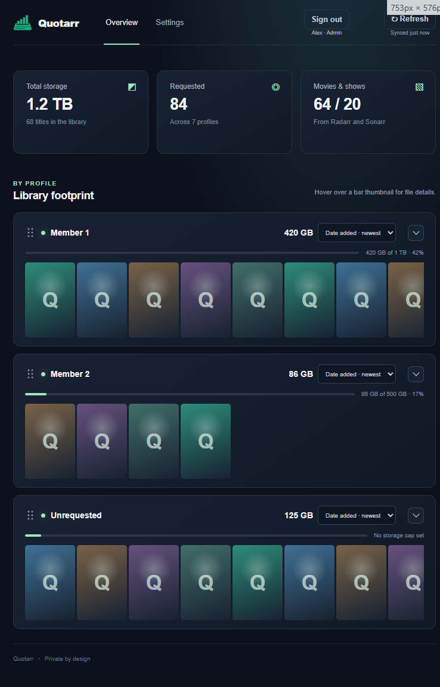
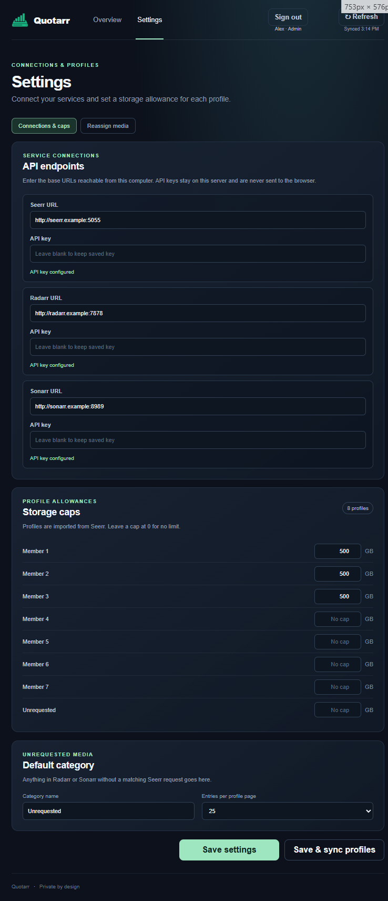

# Quotarr

A self-hosted dashboard that groups Radarr movies and Sonarr series by their Seerr requester, with Jellyfin sign-in, persistent manual reassignment, request history, and per-profile storage caps.

## Screenshots

NOTE: These screenshots use anonymized sample data.
When run it will be populated with actual movie and series images

## Run locally

1. Install Node.js 20 or newer.
2. From this folder, run `npm start`.
3. Open [http://127.0.0.1:4173](http://127.0.0.1:4173).
4. Open **Settings**, enter each service's base URL and API key, then choose **Save & sync profiles**.

The app binds to `127.0.0.1` by default. Set `PORT` to change the port. Use the Jellyfin username and password associated with a Seerr account to sign in. Quotarr verifies the login through Seerr and keeps the Seerr session in memory; passwords are not stored. Seerr's admin permission is required for Settings and reassignment; other signed-in users can view the overview and request history. Sessions expire after 12 hours or when the app restarts.

## Service setup

Use the base address for each service, including a reverse-proxy subpath if applicable (for example `http://media-box:7878/radarr`). Create API keys in each service's settings. The dashboard reads Seerr users and requests, Radarr movies, and Sonarr series; it does not modify those services.

Titles are matched by TMDB ID for movies and TVDB ID for series. If there are multiple requests for the same title, the oldest request owns its storage total. Each profile can expand its request list, search, sort by date added or size, and page through it; page size is configurable in Settings (25 by default). Profile order can be changed by dragging the handle: Seerr administrators save the order globally, while other users save their order in their browser. The signed-in user's profile stays at the top. Requests not yet in Radarr or Sonarr appear with no disk size. Items without a matching Seerr profile go to the configurable default category. Manual assignments are stored locally and take precedence over request matching. Storage amounts come from `sizeOnDisk` in Radarr and Sonarr.

Each profile's sort control orders both its dashboard poster tiles and expanded request list by date added or size. The **Reassign media** section in Settings supports title search, requester/type filters, sorting by date added or size, and bulk assignment of selected or filtered items. Dashboard poster tiles scroll horizontally when needed; hovering a tile shows its poster, title, request date, size, and release date.

Profile caps are entered in GB. A blank or zero cap means unlimited. Connection settings, caps, and overrides are stored in `data/settings.json`; API keys are not returned to the browser. Keep that file private and back it up if you want to preserve settings.

By default, the app only accepts the `localhost` and loopback hostnames. For a trusted LAN deployment, set `HOST=0.0.0.0` and `ALLOWED_HOSTS` to the exact host/IP clients will use (comma-separated if needed). Do not expose the app directly to the internet; use a trusted VPN or HTTPS reverse proxy for remote access.

Poster thumbnails use the services' remote poster URLs where available. If a service has no remote poster URL, the item remains a labeled placeholder.

## Tests

Run `npm test` for assignment, profile-order, authentication, and request-history tests.
